# Presentation plan — Day-ahead forecasting of French electricity demand

**Duration:** ~15 min · **Audience:** course jury + a "head of trading" persona · **Deck:** ~20 core slides (+ optional/backup).
**Images:** every figure below is embedded with its exact relative path (`images/…`) and also listed in **Appendix D**. The
folder `images/` sits next to this file. **Legend:** 🟢 = core slide (keep) · ⚪ = optional / backup (cut first if short on time).

The story in one line: *a naive lag loses to RTE; ARIMA captures the shape but still loses; machine learning (LightGBM, regional
bottom-up) finally beats RTE by ~23%; deep learning ties it but adds calibrated uncertainty for deployment.*

---

## Section 0 — Framing (≈2 min)

### 🟢 Slide 1 — Title
- **Day-ahead forecasting of French electricity demand — can we beat the national grid's own forecast?**
- Names, course (Mastère Data & AI for Finance), date. Hero image:

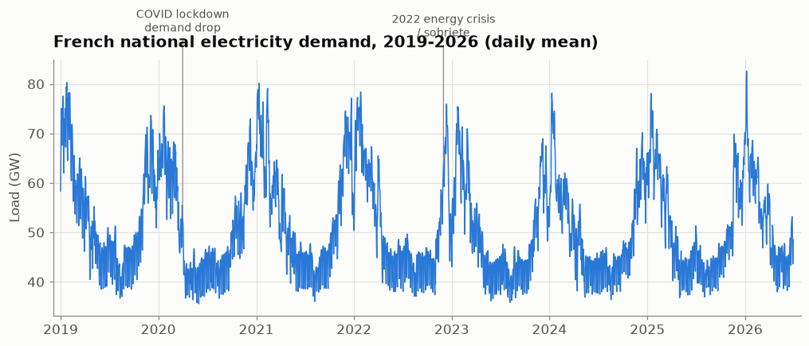

### 🟢 Slide 2 — The problem, in plain terms
- Every day **D**, before the **12:00 market auction**, our utility must state the demand for **all 24 hours of day D+1**.
- We buy that electricity in advance. **Every MWh we get wrong is bought/sold back later at penalty (imbalance) prices.**
- Errors hurt most on **cold winter evenings** — the demand peak, where prices spike too.
- So the task: **forecast tomorrow's 24 hourly demands, using only what we know by noon today.**

### 🟢 Slide 3 — Objective & the 3 questions we must answer
- **Objective:** build an honest day-ahead forecaster and benchmark it against **RTE** (the French grid operator's public forecast).
- **Q1 — Can we beat RTE, honestly measured?**
- **Q2 — How uncertain is the forecast, and when does it fail?**
- **Q3 — What should we deploy, and what are the risks?**
- One rule throughout: **no data from after the noon cutoff is ever used** (no leakage).

---

## Section 1 — Data, exploration & the benchmark (≈3.5 min)

### 🟢 Slide 4 — The data
- **National:** 65,712 hourly rows, **2019-01 → 2026-06** (UTC). Columns: `load_mw` (target), `rte_forecast_d1_mw`
  (benchmark), `temperature_c`, + calendar (hour, weekday, month, holiday, season).
- **Regional:** 12 French regions, hourly, 2023-2026 (367,752 rows) — used for the hierarchical/bottom-up models.

### ⚪ Slide 5 — Data preparation (Notebook 00)
- Cleaning was light: **only 7 missing national values (0.011%)**, all at the **autumn DST change**, imputed by time interpolation.
- Regional: 36 gaps imputed; **regions reconcile to the national total to ~16 MW (0.03%)** — data is coherent.

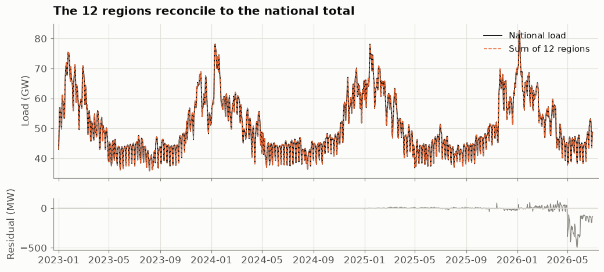

### 🟢 Slide 6 — Demand has strong, learnable structure
- Three nested cycles: **daily (24 h)**, **weekly (168 h)**, **yearly** (winter peak). Peaks = **winter evenings ~19:00**;
  troughs = **summer nights**; weekends sit several GW below weekdays.

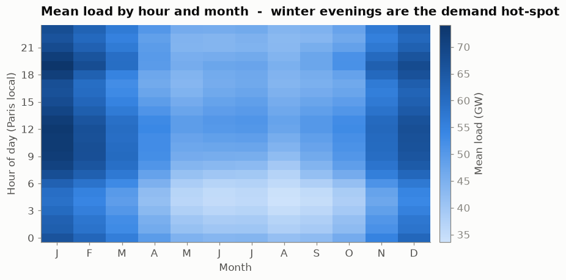

_Optional add:_

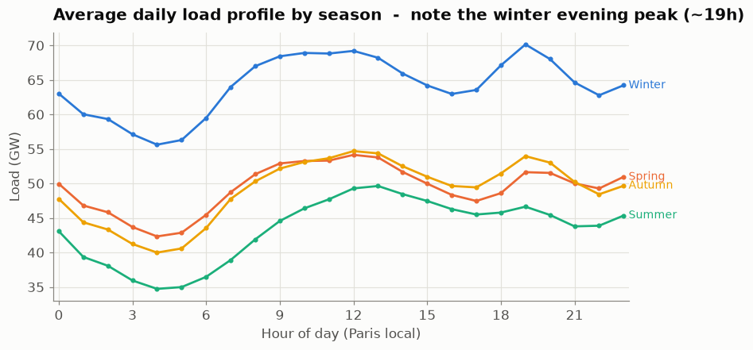

### 🟢 Slide 7 — Statistical backing (why this matters for modelling)
- **Autocorrelation:** Ljung-Box **p ≈ 0 at lags 1, 24, 168** → strong hourly/daily/weekly memory.
- **Stationarity:** raw series is non-stationary (KPSS rejects); it becomes **stationary after seasonal (lag-24) differencing**
  → justifies the (S)ARIMA orders used later.

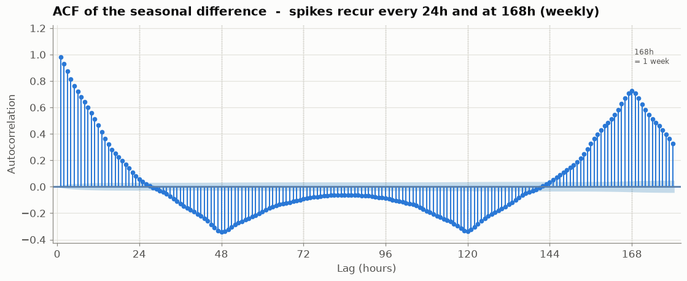

_Optional add:_

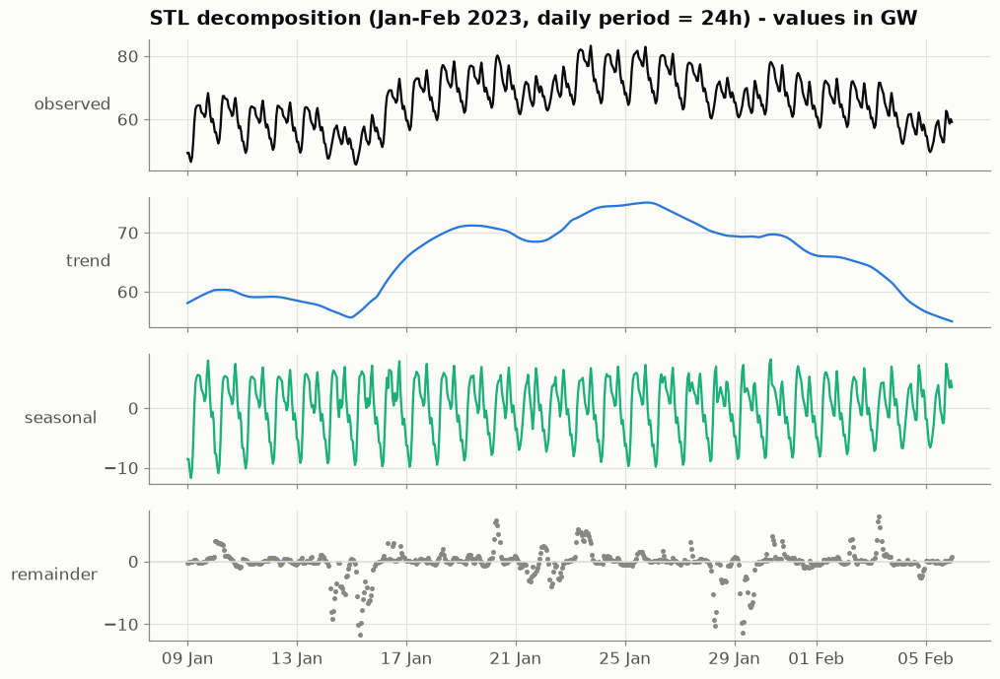

### 🟢 Slide 8 — Temperature: the dominant driver
- Load vs temperature is a **non-linear "hockey stick"**: heating below ~15 °C, light cooling above ~20 °C.
- Raw correlation **r = −0.60**, but a **heating-degree-day transform lifts it to +0.72** → motivates degree-day features.
- France is **heating-dominated** (cooling signal weak, r ≈ −0.12).

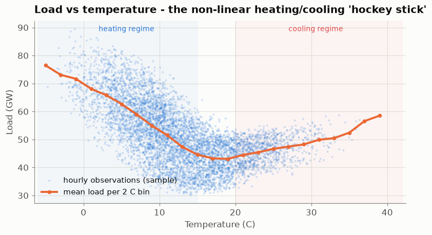

### ⚪ Slide 9 — Regions differ (motivates the bottom-up idea)
- Regions share France's rhythm but not identically — some have **steeper evening peaks / deeper night troughs**.
- A single national model averages this away; a **per-region bottom-up** model can exploit it (used in ML/DL).

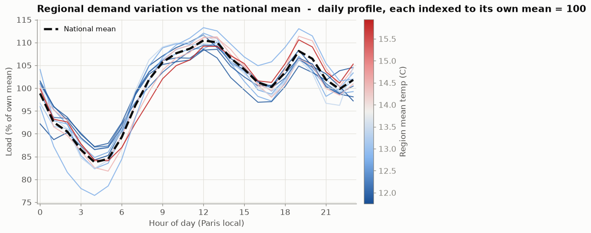

### 🟢 Slide 10 — The benchmark to beat: RTE (Q1 framing)
- RTE day-ahead error (full history): **MAE ≈ 1.14 GW · RMSE ≈ 1.49 GW · MAPE ≈ 2.25%**.
- It has a **small but significant under-forecast bias (+0.67 GW, t-test p ≈ 0)** and **residuals still autocorrelated** at
  24/168 h → *there is structure left on the table.*
- It fails most in **evening peaks and temperature extremes** — exactly where errors cost most → **our opportunity.**

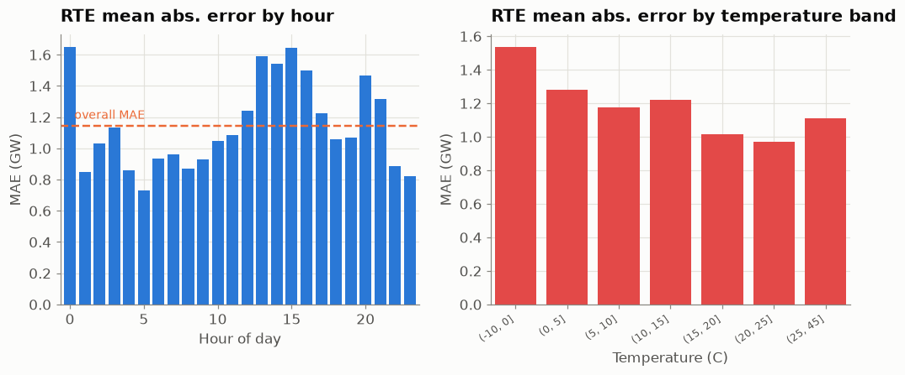

### 🟢 Slide 11 — The floor: naive baselines
- Trivial "repeat the past" rules set the floor. **Shorter lag wins:** day-to-day persistence beats week- and year-lags.

| Forecast | MAE (GW) | MAPE | × vs RTE |
|---|---|---|---|
| **RTE** | **1.19** | 2.4% | 1.0 |
| Naive-daily (D-1, lag 24) | 2.61 | 5.2% | 2.2× worse |
| Naive-weekly (D-7, lag 168) | 3.52 | 6.5% | 3.0× worse |
| Seasonal-cascade (1y→1w→1d) | 4.13 | 7.8% | 3.5× worse |

- Takeaway: RTE is a **serious bar (2–3.5× better than any naive rule)**, not a strawman.

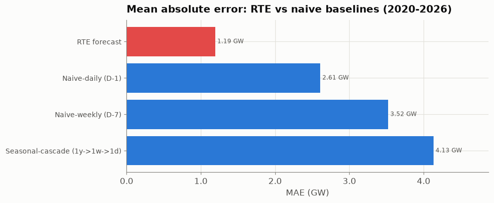

_Optional add:_

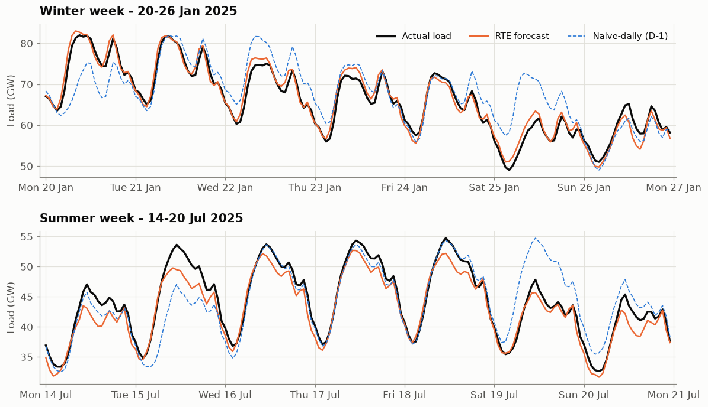

### 🟢 Slide 12 — Honest evaluation protocol
- **Chronological split, never shuffled:** train **2019-2023**, validate **2024**, test **2025 – 2026-06** (a locked box).
- Day-ahead rule: decide at **12:00 on day D**, forecast all of **D+1** using only pre-cutoff information.

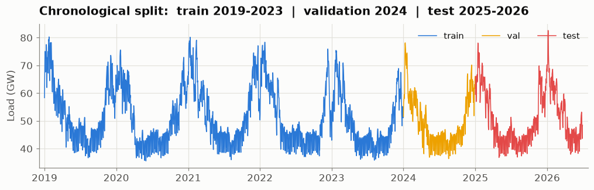

---

## Section 2 — Approach 1: classical time series (ARIMA) (≈2.5 min)

### 🟢 Slide 13 — The idea: "normal + anomaly"
- A plain ARIMA can't absorb the 24/168 h cycles, and seasonal ARIMA on 65 k points is intractable. So we **split**:
  $$ y_t = \underbrace{m_{(\text{season, weekday, hour})}}_{\text{seasonal normal (train only)}} + \underbrace{a_t}_{\text{anomaly}} $$
- We model the **anomaly** `a_t` with a non-seasonal ARIMA, then rebuild `load = normal + forecast anomaly`.

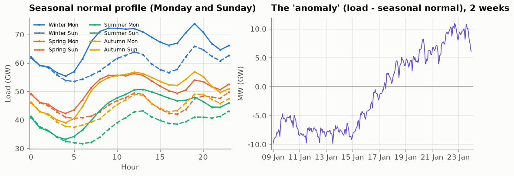

### 🟢 Slide 14 — Two ARIMA forecasts + order selection
- **ARIMA(p,0,q)** on the anomaly: $$ a_t = \sum_{i=1}^{p}\varphi_i a_{t-i} + \varepsilon_t + \sum_{j=1}^{q}\theta_j \varepsilon_{t-j} $$
- **① Recursive:** rolls its **own predictions** forward from the cutoff across the whole day; resets to real data each new day.
- **② Lag-window (24/48):** one ARIMA per hour-of-day on that hour's **daily** series; forecasts each hour from the **real**
  most-recent same-hour value — **lag 24** for hours 00–11, **lag 48** for 12–23 (always observed at the cutoff).
- Orders chosen by a **(p,q) grid on validation MAE:** recursive → **ARIMA(1,0,0)**; lag-window → **ARIMA(3,0,2)**.

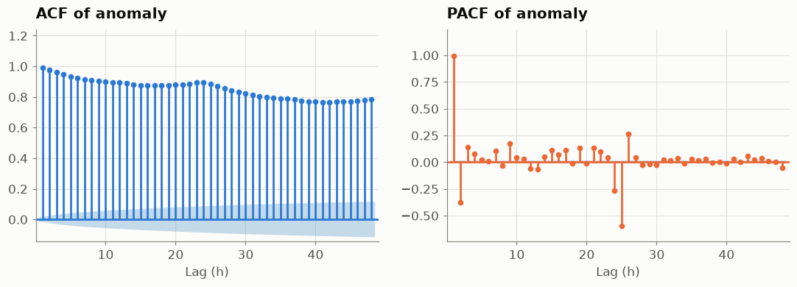

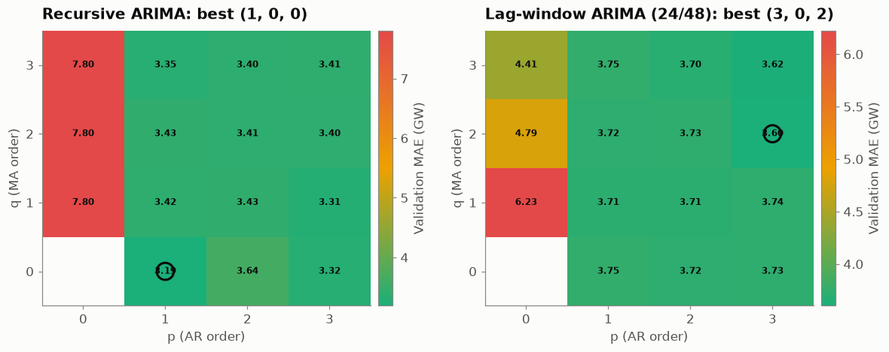

### 🟢 Slide 15 — ARIMA results vs RTE (56-day test)

| Model | MAE (GW) | RMSE (GW) | MAPE |
|---|---|---|---|
| Recursive ARIMA(1,0,0) | 2.51 | 3.58 | 4.0% |
| Lag-window ARIMA(3,0,2) | 2.64 | 3.77 | 4.2% |
| Raw-lag hybrid (no fit) | 3.63 | 4.74 | 5.7% |
| **RTE** | **1.37** | **1.71** | **2.1%** |

- The two ARIMAs **tie each other** (Wilcoxon p = 0.64) and both **beat the raw-lag copy** (p = 1e-4) — but **still trail RTE**.
- Why: ARIMA models demand *persistence* only; **it has no weather.** That gap is the whole point of the next approach.

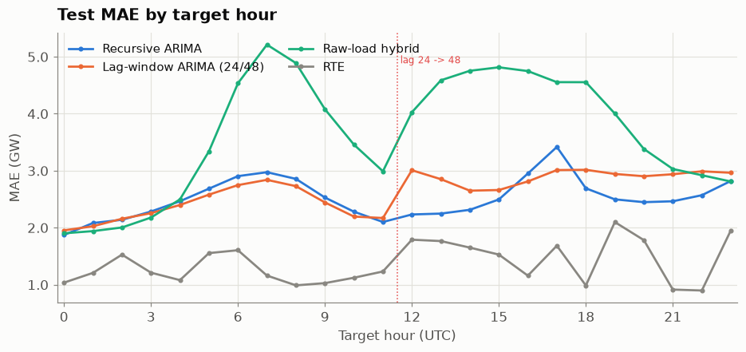

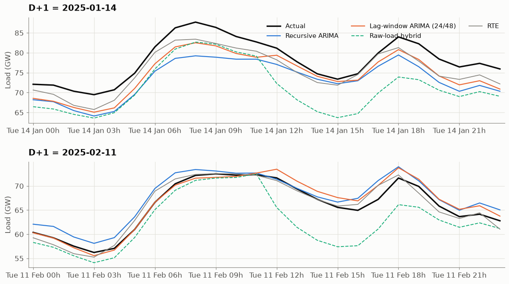

---

## Section 3 — Approach 2: machine learning (≈3 min)

### 🟢 Slide 16 — Feature engineering (honest day-ahead table)
Everything is knowable at the noon cutoff. **34 features** (18 numeric + 12 region one-hots + 4 season one-hots):
- **Demand history (safe, ≥48 h):** `lag_48, 72, 96, 120, 144, 168, 336`, a **7-day level** `roll7`, and the cutoff-safe
  **`recent`** = hybrid 24/48 most-recent same-hour load: $$ \text{recent}_t = \begin{cases} y_{t-24} & \text{hour} < 12 \\ y_{t-48} & \text{hour} \ge 12 \end{cases} $$
- **Weather:** tomorrow's temperature as a **noised forecast** `temp_fcst`, degree-days `hdd = max(16−T,0)`, `cdd = max(T−20,0)`, `temp_lag48`.
- **Calendar:** `hour, dow, month, is_weekend, is_holiday`, `season`.
- Leakage guard: every demand lag ≥ 48 h; `recent` is the verified 24/48; temperature is a *forecast*, not the actual.

### 🟢 Slide 17 — Design: global regional, bottom-up
- **One** LightGBM/XGB/RF/Tree trained on **all 12 regions stacked** (region is a feature); predict each region, then
  **sum the 12 → national** forecast: $$ \hat{y}^{\text{nat}}_t = \sum_{r=1}^{12}\hat{y}^{\,r}_t $$
- Benchmark four tree models vs RTE on the 2025-2026 test.

### 🟢 Slide 18 — ML results: first model to beat RTE (Q1 = yes)

| Model | National MAE (GW) | MAPE | vs RTE |
|---|---|---|---|
| **LightGBM** | **1.13** | 2.1% | **−23%** |
| XGBoost | 1.15 | 2.2% | −22% |
| **RTE** | **1.47** | 2.9% | — |
| Random Forest | 1.59 | 3.0% | +8% |
| Decision Tree | 1.67 | 3.2% | +14% |

- **LightGBM beats RTE by ~23%**, statistically significant (**Wilcoxon p ≈ 6e-26**) — the first affirmative **Q1**.
- Honest caveat: the edge **partly rests on an idealised noised-weather input** (independent N(0, 1.2 °C)).

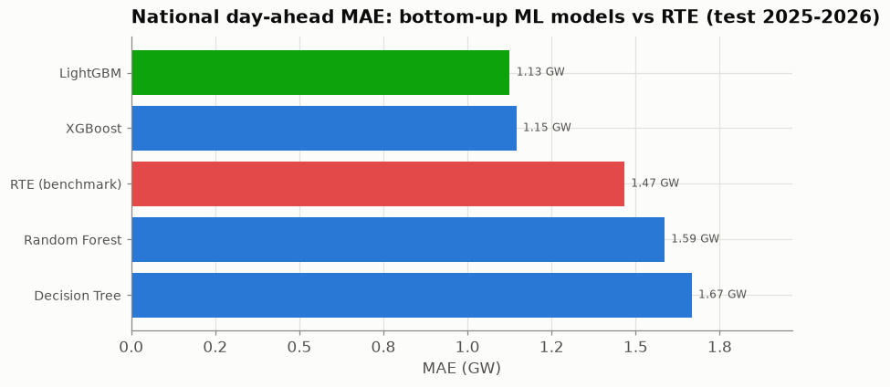

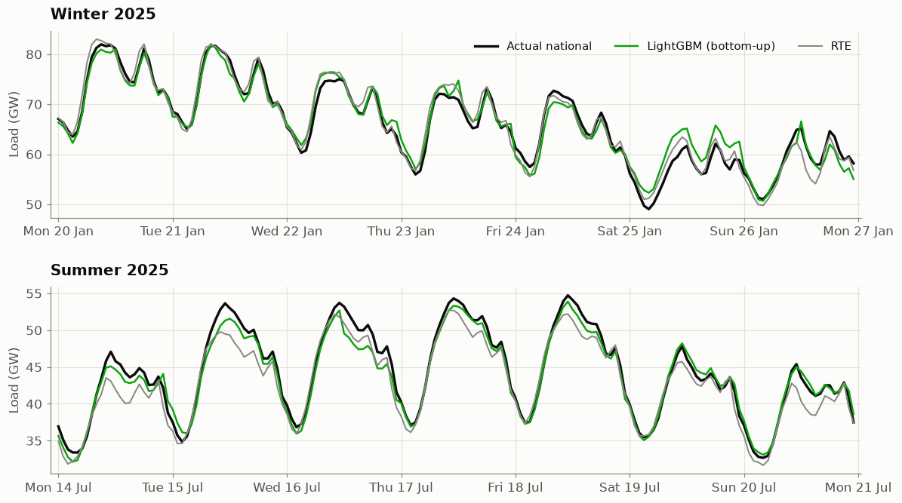

### 🟢 Slide 19 — What the model leans on (feature influence)
- **By gain (true contribution):** `recent` (hybrid 24/48) **76%** + `lag_168` (last week) **18%** ⇒ demand history ≈ **97%**.
- The split-count chart looks more spread (roll7, hour, weekday) — but gain shows it's essentially a **smart persistence model**,
  with weather/calendar/region as fine-tuning. *(Honest reframing — strong for the defence.)*

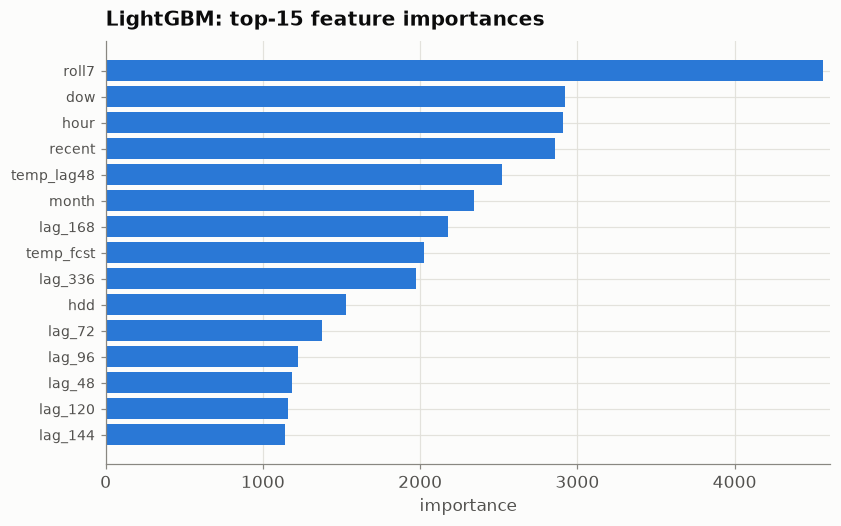

### 🟢 Slide 20 — Local vs global models
- **Local** = a separate model per region; **Global** = one model, region as a feature. Same features, same split.
- **Global wins everywhere:** lower MAE in **all 12 regions**, national **1.13 vs 1.24 GW** (Wilcoxon p = 3e-9). Both beat RTE.
- Why: with only **2 years** per region, pooling gives ~12× data; local models are data-starved and spread onto weaker signals.

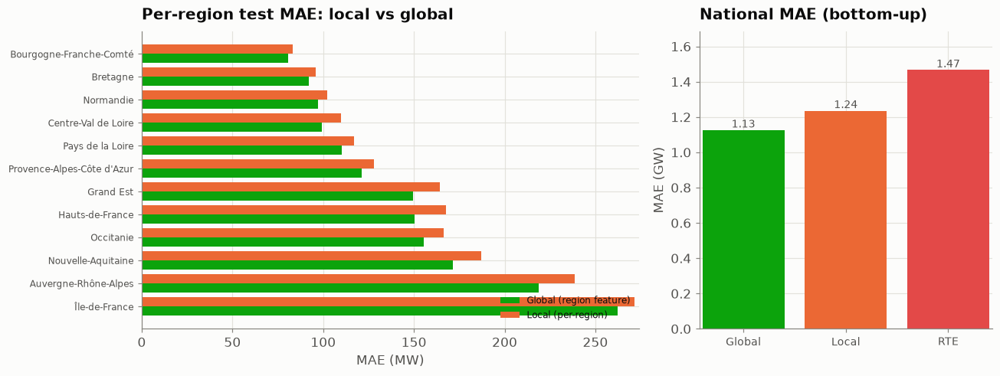

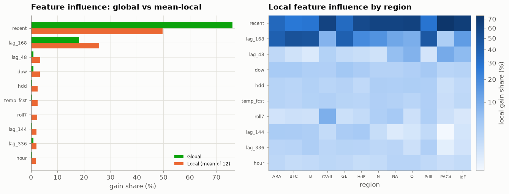

### ⚪ Slide 21 — Per-region forecasts & error comparison
- Absolute MAE tracks **region size** (Île-de-France largest); size-adjusted **MAPE** reorders it — tightest in PACA /
  Hauts-de-France (~2.7%), hardest in Centre-Val de Loire (4.9%).

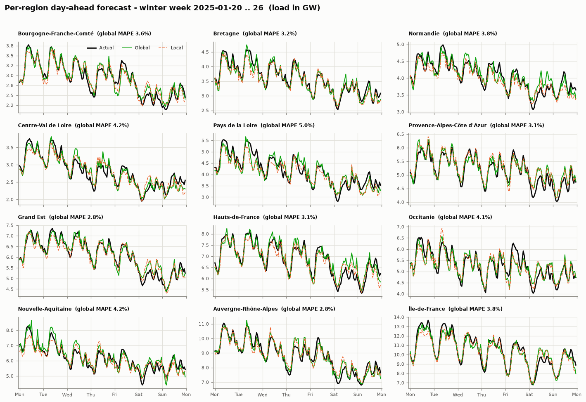

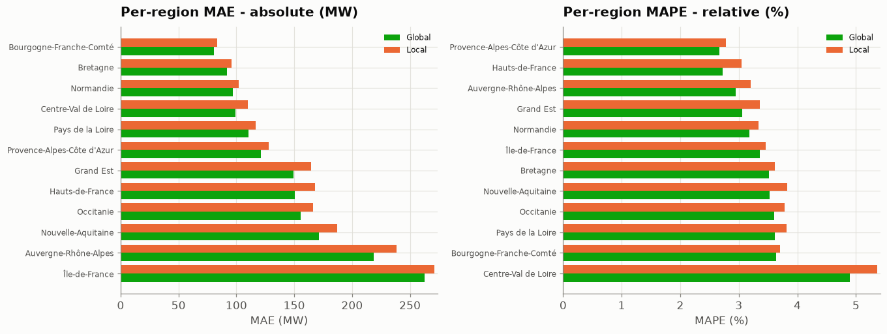

---

## Section 4 — Approach 3: deep learning & uncertainty (≈2.5 min)

### 🟢 Slide 22 — A global deep forecaster
- **One PyTorch MLP across all 12 regions** (76 honest day-ahead features: safe lags with centered windows, hybrid 24/48,
  7-day level, noised temp + degree-days, calendar), summed bottom-up.

| Model | National MAE (GW) | MAPE |
|---|---|---|
| LightGBM | 1.12 | 2.1% |
| **Deep MLP** | **1.43** | 2.8% |
| RTE | 1.47 | 2.9% |

- On **tabular** day-ahead features the MLP **ties RTE but does not beat the trees** — its value is a second, independent model
  and the backbone for uncertainty.

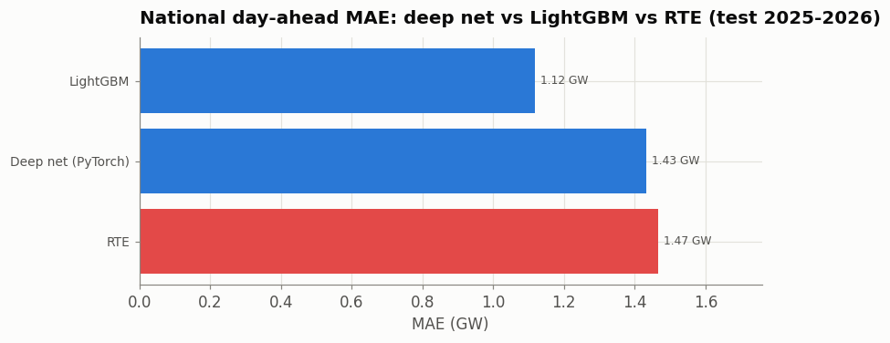

### 🟢 Slide 23 — Forecasts with uncertainty (Q2)
- Two ways to get an **80% prediction interval**: **quantile regression** (pinball loss) vs **split conformal** (distribution-free).

| Method | Coverage (target 80%) | Mean width | Winkler |
|---|---|---|---|
| Quantile (LightGBM) | **69%** (under-covers) | 3.31 GW | 5,953 |
| Split conformal | **78% ≈ 80%** (calibrated) | 3.98 GW | 6,645 |

- Quantile is sharper but **over-confident out-of-sample**; conformal is **well-calibrated** thanks to its finite-sample guarantee.

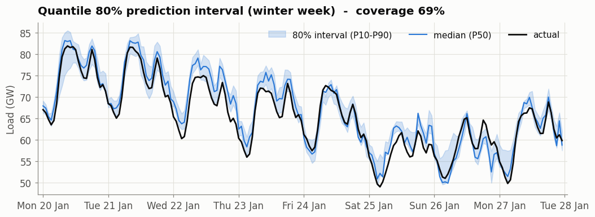

### 🟢 Slide 24 — When does it fail? (Q2)
- **Coverage by hour dips in the afternoon/evening peak** — precisely when demand is highest and errors cost most.
- For sizing reserves, **calibration beats sharpness** → deploy the **conformal** interval.

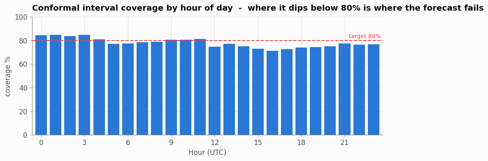

---

## Section 5 — Synthesis & recommendation (≈1.5 min)

### 🟢 Slide 25 — Every approach vs RTE (the whole story in one chart)
- Normalised to **each model's own test window** (MAE ÷ RTE on the same window; < 1 beats RTE).
- Naive ~2.2× → ARIMA ~1.8–1.9× → Deep MLP ~0.98× → **LightGBM global 0.77×**.

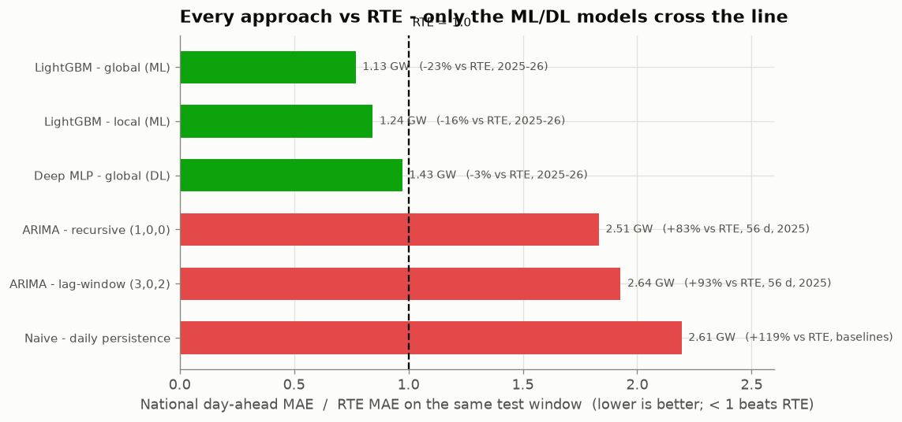

### 🟢 Slide 26 — Answers to the three questions
- **Q1 — Beat RTE?** ✅ **Yes** — LightGBM bottom-up, **−23% MAE** (p ≈ 6e-26), *under the noised-weather assumption.*
- **Q2 — Uncertainty / when it fails?** 80% **conformal** interval (calibrated 78%); reliability **dips on evening peaks.**
- **Q3 — What to deploy?** **LightGBM point forecast + conformal 80% interval**, retrain often, keep **RTE as fallback.**

### ⚪ Slide 27 — Risks & honesty (say this out loud)
- The ~23% edge **partly rests on an idealised independent noised-weather input**; a realistic correlated forecast error
  would shrink it (and bite hardest on cold/hot extremes).
- Single chronological holdout (no walk-forward yet); regional training limited to the 2023-2024 era.

### ⚪ Slide 28 — Conclusion & next steps
- Delivered: clean data → statistical framing → ARIMA → ML (beats RTE) → DL + calibrated uncertainty.
- Next: **real walk-forward** validation, **weather stress-test** (noisier/correlated), SARIMAX, hierarchical reconciliation.

---

## Appendix A — Forecasting equations (reference / backup slide)

- **Error metrics:** `MAE = mean|y−ŷ|`, `RMSE = sqrt(mean((y−ŷ)²))`, `MAPE = 100·mean(|y−ŷ|/y)`.
- **Naive:** daily `ŷ_t = y_{t−24}`; weekly `ŷ_t = y_{t−168}`.
- **Normal + anomaly:** `y_t = m_{s,d,h} + a_t` (m = train mean by season×weekday×hour).
- **ARIMA(p,0,q):** `a_t = Σ φ_i a_{t−i} + ε_t + Σ θ_j ε_{t−j}`; forecast `ŷ = m + â`.
- **Recursive multi-step:** later steps reuse earlier predicted `â`.
- **Lag-window input:** `recent_t = y_{t−24}` if hour < 12 else `y_{t−48}`.
- **Degree-days:** `HDD = max(16 − T, 0)`, `CDD = max(T − 20, 0)`.
- **Bottom-up national:** `ŷ_nat = Σ_{r=1..12} ŷ_r`.
- **Pinball loss (quantile τ):** `L_τ = max(τ(y−ŷ), (τ−1)(y−ŷ))`.
- **Split conformal interval:** `[ŷ − q, ŷ + q]`, `q =` (1−α) quantile of |residuals| on a held-out calibration set.

## Appendix B — Feature lists

**ML (Notebook 3) — 34 features**
- Demand: `lag_48, lag_72, lag_96, lag_120, lag_144, lag_168, lag_336, roll7, recent`
- Weather: `temp_fcst, hdd, cdd, temp_lag48`
- Calendar: `hour, dow, month, is_weekend, is_holiday`
- Identity (one-hot): 12 × region, 4 × season

**Deep learning (Notebook 4) — 76 features**
- Same families as ML, plus **centered 7-hour windows** (3 h before/after each safe lag), standardised inputs & target.

## Appendix C — Master results table (national day-ahead)

| Approach | Model | Test window | MAE (GW) | MAPE | vs RTE |
|---|---|---|---|---|---|
| Baseline | Naive-daily (D-1) | baselines | 2.61 | 5.2% | 2.2× worse |
| Benchmark | **RTE** | — | 1.14–1.47* | 2.25–2.9% | 1.0 |
| ARIMA | Recursive (1,0,0) | 56 d, 2025 | 2.51 | 4.0% | 1.8× worse |
| ARIMA | Lag-window (3,0,2) | 56 d, 2025 | 2.64 | 4.2% | 1.9× worse |
| ML | LightGBM — local | 2025-26 | 1.24 | 2.3% | −16% |
| ML | **LightGBM — global** | 2025-26 | **1.13** | **2.1%** | **−23%** |
| DL | Deep MLP — global | 2025-26 | 1.43 | 2.8% | ~tie |

\* RTE's MAE depends on the window (1.14 GW full history, 1.37 GW on the 56-day ARIMA test, 1.47 GW on the 2025-26 ML/DL test);
always compare each model to RTE **on its own window** (what Slide 25 does).

## Appendix D — Image index (exact links, folder `images/`)

1. [images/s04_demand_overview.png](images/s04_demand_overview.png) — national demand, 2019–2026
2. [images/s05_regional_reconciliation.png](images/s05_regional_reconciliation.png) — regions → national
3. [images/s06_seasonality_heatmap.png](images/s06_seasonality_heatmap.png) — hour × month heatmap
4. [images/s06b_daily_profile.png](images/s06b_daily_profile.png) — average daily profile
5. [images/s07_acf.png](images/s07_acf.png) — autocorrelation (ACF)
6. [images/s07b_stl_decomposition.png](images/s07b_stl_decomposition.png) — STL decomposition
7. [images/s08_load_vs_temperature.png](images/s08_load_vs_temperature.png) — load vs temperature
8. [images/s09_regional_variation.png](images/s09_regional_variation.png) — regional variation
9. [images/s10_rte_error_breakdown.png](images/s10_rte_error_breakdown.png) — where RTE fails
10. [images/s11_naive_baselines.png](images/s11_naive_baselines.png) — naive baselines vs RTE
11. [images/s11b_forecast_vs_actual_weeks.png](images/s11b_forecast_vs_actual_weeks.png) — RTE vs naive, weeks
12. [images/s12_train_val_test_split.png](images/s12_train_val_test_split.png) — train/val/test split
13. [images/s13_normal_anomaly.png](images/s13_normal_anomaly.png) — normal + anomaly
14. [images/s14_anomaly_acf_pacf.png](images/s14_anomaly_acf_pacf.png) — anomaly ACF/PACF
15. [images/s14b_arima_pq_tuning.png](images/s14b_arima_pq_tuning.png) — ARIMA (p,q) grids
16. [images/s15_arima_mae_by_hour.png](images/s15_arima_mae_by_hour.png) — ARIMA MAE by hour
17. [images/s15b_arima_example_days.png](images/s15b_arima_example_days.png) — ARIMA example days
18. [images/s18_ml_national_benchmark.png](images/s18_ml_national_benchmark.png) — ML vs RTE
19. [images/s18b_ml_national_forecast.png](images/s18b_ml_national_forecast.png) — LightGBM forecast weeks
20. [images/s19_ml_feature_importance.png](images/s19_ml_feature_importance.png) — feature importance
21. [images/s20_local_vs_global.png](images/s20_local_vs_global.png) — local vs global MAE
22. [images/s20b_feature_influence_local_global.png](images/s20b_feature_influence_local_global.png) — feature influence local/global
23. [images/s21_region_forecasts.png](images/s21_region_forecasts.png) — per-region forecasts
24. [images/s21b_region_error_comparison.png](images/s21b_region_error_comparison.png) — per-region error
25. [images/s22_deep_benchmark.png](images/s22_deep_benchmark.png) — deep MLP vs trees vs RTE
26. [images/s23_uncertainty_interval.png](images/s23_uncertainty_interval.png) — 80% interval
27. [images/s24_coverage_by_hour.png](images/s24_coverage_by_hour.png) — coverage by hour
28. [images/s25_overall_comparison.png](images/s25_overall_comparison.png) — every approach vs RTE
